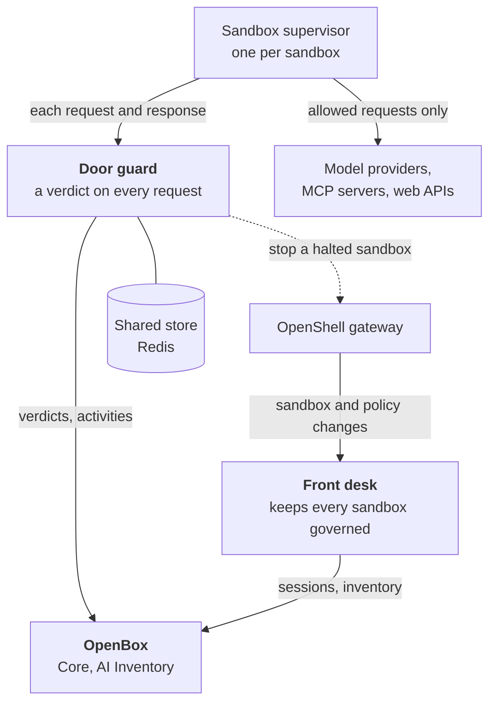

# OpenShell Reference

OpenBox for OpenShell governs [NVIDIA OpenShell](https://github.com/NVIDIA/OpenShell)
sandboxes through OpenShell's own extension points. Two services, deployed
together beside the OpenShell gateway, do the work:

| Service | Binary | Registered with the gateway as | Role |
|---|---|---|---|
| Door guard | `openbox-verdict-middleware` | supervisor middleware `openbox` | Asks OpenBox Core for a verdict on every request a sandbox makes, and records each response. |
| Front desk | `openbox-governance-interceptor` | gateway interceptors `openbox` and `openbox-inventory` | Attaches the door guard to every new sandbox, refuses policy changes that weaken it, opens and closes each sandbox's session, and keeps the AI Inventory up to date. |

Both ship in one image, `ghcr.io/openbox-ai/openbox-openshell`, installed by
one Helm chart. Source, issues and releases are in
[OpenBox-AI/openbox-openshell](https://github.com/OpenBox-AI/openbox-openshell).
To install it, start with [Getting Started with OpenShell](/getting-started/openshell).

## Architecture



| Service | Talks to | Listens on | On failure |
|---|---|---|---|
| Door guard | OpenBox Core over HTTPS with the agent's workload identity; the gateway API over mTLS to stop a halted sandbox | `:50051` gRPC, plus an admin port (`9464`) for `/metrics` and health | Fail closed: requests are denied |
| Front desk, governing | – | `:50061` gRPC | Fail closed: sandbox creates and policy changes are refused |
| Front desk, recording | OpenBox Core (sessions) and the AI Inventory API over HTTPS; the gateway API over mTLS to reconcile | `:50062` gRPC | Fail open: the change still happens; the inventory catches up on reconcile |
| Shared store | – | Redis | Nothing is skipped; an approval's retry may need approving again |

Run two or more door guard replicas behind the shared store. Because the door
guard fails closed, OpenBox availability is sandbox availability: plan for it
the way you plan for the gateway. See [Operations](/developer-guide/openshell/operations).

## One request, start to finish

1. The sandbox supervisor sends the request (method, URL, headers, and body up
   to the registered `max_payload_bytes`) to the door guard, with a
   short-lived gateway token.
2. The door guard works out what the request is. A call to a model provider is
   the agent thinking (`llm_call`); a call the model asked for is a tool;
   anything else is plain HTTP inside the current tool.
3. It opens that activity in the sandbox's OpenBox session and asks Core for a
   verdict, all within one 29 s budget so the answer always beats OpenShell's
   30 s middleware timeout.
4. The verdict becomes allow or deny with a [reason code](/developer-guide/openshell/approvals#reason-codes).
   A halt also stops the sandbox through the gateway.
5. When the response comes back, the door guard records it and closes the
   activity. If the model's reply asked for tools, it opens them.

Each sandbox is one session in the OpenBox dashboard, holding these activities
in order. The door guard sends each sandbox's events to Core in order, so one
busy sandbox does not slow the others.

## What every sandbox gets

On every `CreateSandbox`, the front desk adds an `openbox` entry to the
sandbox's network policy:

- middleware `openbox`, every host (`**`), `on_error: fail_closed`
- `order` 1000, or higher than any other entry, so it runs after your own
  middleware (such as redaction) and the verdict covers what actually leaves
- `config: { approval_mode: queue }`, plus the policy author's `profile`,
  `capture` and `capture_hosts` when the policy sets them
- hosts on `tls: skip` endpoints left out, because OpenShell cannot inspect
  them and refuses a fail-closed middleware that selects them

It also labels the sandbox `openbox.ai/governed=true`. A sandbox created
without `--policy` gets OpenShell's restrictive default policy with OpenBox
attached. A policy shipped inside the sandbox image is ignored; pass `--policy`
to use it.

On create and on every policy change, the front desk refuses:

- a policy whose `openbox` entry is missing, uses another middleware, or does
  not fail closed
- any endpoint with `allow_uninspected_credentials`, which would send a
  credential past the door guard
- turning on automatic approval of policy proposals the agent writes for
  itself

A refused change returns `PERMISSION_DENIED` to the `openshell` CLI with the
reason.

## What Core receives

Core always receives the request's metadata: method, URL (including its query
string), host and port, status code, header names and values with credential
headers (`Authorization`, `Cookie`, `X-API-Key` and similar) replaced by
`[REDACTED]`, the sandbox and process that made the request, the model's name
and token counts, and the name of each tool. Put secrets in headers or bodies,
not in URLs.

What part of the content leaves your boundary is set by a capture mode. The
default, `findings`, sends a hash, the kinds of sensitive data found and the
shape of any JSON, never the text. See
[Content capture](/developer-guide/openshell/configuration#content-capture).

## What is not governed

Some traffic gets an allow or deny by host and port only, without a
per-request verdict:

- raw TCP (`protocol: tcp`, for example Postgres, SSH or Redis)
- hosts marked `tls: skip`, which OpenShell cannot inspect
- WebSocket messages after the upgrade request, which the door guard scores
  locally rather than through Core (see
  [Responses and WebSocket messages](/developer-guide/openshell/controls#responses-and-websocket-messages))

Put internal systems behind HTTP or MCP to govern them per request.

## Known limits

- **Approval is deny-then-retry.** OpenShell has no way to hold a request
  while a person decides.
- **Verdicts take seconds.** A model-call verdict takes 3 to 8 seconds; a
  person using an agent interactively will notice. A slow verdict can still
  fail on an allow if the destination drops the idle upstream connection first
  (about 15 s for some hosts), and a change to the sandbox's policy drops
  requests still waiting on a verdict.
- **Responses are judged locally.** The door guard checks responses for
  secrets, injected instructions and (when asked) personal data; Core does not
  decide on them. Blocking a response stops delivery only: the upstream call
  has already run. Compressed responses carry no readable body and are
  delivered unjudged.
- **The mounted workspace** is a write path to the host, limited by Landlock.
- **Model calls behind a proxy.** The dashboard shows a model call as an LLM
  call only for known provider domains (OpenAI, Anthropic, Google,
  OpenRouter). A model behind a proxy shows as plain HTTP, though the door
  guard still records it as `llm_call`.
- **In OpenShell v0.1.8:** spans carry no process lineage
  ([NVIDIA/OpenShell#4269](https://github.com/NVIDIA/OpenShell/issues/4269)),
  plain-HTTP URLs are recorded as `https://host:80`
  ([NVIDIA/OpenShell#4253](https://github.com/NVIDIA/OpenShell/issues/4253)),
  and OCSF events do not carry the request id.

## Releases

Each release publishes:

| What | Where |
|---|---|
| Image, `linux/amd64` and `linux/arm64` | `ghcr.io/openbox-ai/openbox-openshell:<version>` |
| Helm chart | `oci://ghcr.io/openbox-ai/charts/openbox-openshell --version <version>` |
| Notes and the packaged chart | [GitHub Releases](https://github.com/OpenBox-AI/openbox-openshell/releases) |

The chart's version, its `appVersion` and the image tag are always the same, so
a chart installs the image it was released with. The image runs as UID 65532
with a read-only root filesystem.

The image and the chart are signed with [cosign](https://docs.sigstore.dev),
and the image carries an SBOM and build provenance. Check a release before you
install it, with **cosign v3 or later** (cosign 2 does not find the
signatures):

```bash
cosign verify ghcr.io/openbox-ai/openbox-openshell:<version> \
  --certificate-identity-regexp '^https://github.com/OpenBox-AI/openbox-openshell/\.github/workflows/release\.yml@refs/tags/v' \
  --certificate-oidc-issuer https://token.actions.githubusercontent.com
```

The same command with `ghcr.io/openbox-ai/charts/openbox-openshell:<version>`
checks the chart.
