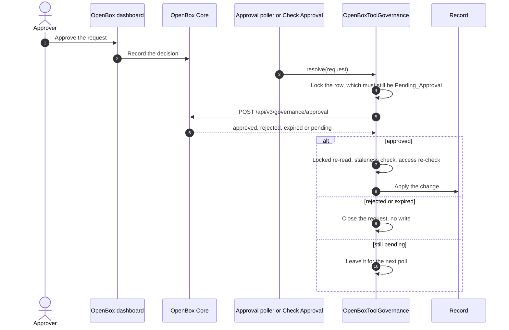

# Building a Governed Agent

Everything here builds on the [Quickstart](/getting-started/salesforce-agentforce#quickstart):
the conversation is hooked, and the agent passes its conversation key
(`ob_conversation_key`) to every governed action, so each call joins the
conversation's OpenBox session.

There are three ways to put a tool under OpenBox, depending on what it does:

| The tool | Use |
|---|---|
| Runs Apex you write | [An Apex tool](#apex-tools): implement `OpenBoxToolExecutor` |
| Changes a field on a record | [A record writer](#record-writes-and-guarded-fields): extend `OpenBoxRecordWriter`, and guard the field |
| Is a flow, standard action or existing invocable Apex | [A registered tool](#flows-standard-actions-and-invocable-apex): one custom metadata record, no Apex |

## Apex tools

Implement `OpenBoxToolExecutor` and call `OpenBoxToolGovernance.govern(...)`,
or `governAll(...)` for several calls, as in
[Govern your first tool](/getting-started/salesforce-agentforce#5-govern-your-first-tool).

```apex
public class Finder implements OpenBoxToolExecutor {
    public Map<String, Object> execute(OpenBoxToolContext context, Map<String, Object> input) {
        // The tool's work. It runs only after OpenBox allows the call.
    }
}
```

```apex
OpenBoxToolGovernance.ToolCall call = new OpenBoxToolGovernance.ToolCall();
call.sessionKey = conversationKey;
call.toolName = 'find_account';
call.input = new Map<String, Object>{ 'name' => name };
call.targetType = OpenBoxToolGovernance.TARGET_APEX_EXECUTOR;
call.targetName = Finder.class.getName();
call.readOnly = true;
OpenBoxToolGovernance.Result result = new OpenBoxToolGovernance().govern(call);
```

- **`toolName`** is the `activity_type` OpenBox policies match on. **`input`**
  becomes the `activity_input` they read.
- **`readOnly = true`** marks a lookup. Output guardrails apply to its result
  before the agent sees it.
- **An executor resumed after approval** runs in a background job, as a
  different user than the one who asked. It must check access for
  `context.requestedById` itself, and it needs a public no-argument constructor
  so it can be rebuilt by class name.
- **Throwing from `execute`** reports the call as failed, and rolls back
  whatever it changed.

### The result

`govern` returns an `OpenBoxToolGovernance.Result`. The fields you will use
most:

| Field | Meaning |
|---|---|
| `executed` | `true` only when the tool actually ran |
| `output` | What `execute` returned, when it ran |
| `status` | The governed request's status, such as `Executed`, `Pending_Approval` or `Blocked` (see [Request statuses](/developer-guide/salesforce-agentforce#request-statuses)) |
| `verdict` | OpenBox's verdict |
| `message` | A plain-language outcome to relay to the user, including OpenBox's refusal |
| `requestNumber` | The governed request's number, to give the user when the call waits for approval |
| `approvalExpiresAt` | When a waiting approval expires |

## Record writes and guarded fields

To put a field behind OpenBox, extend `OpenBoxRecordWriter` and describe the
change. The SDK does the lookup, the decision, the locked re-read, the
staleness and access checks, and the write.

```apex title="AccountCreditLimitWriter.cls"
public with sharing class AccountCreditLimitWriter extends OpenBoxRecordWriter {
    public override SObjectType objectType() { return Account.SObjectType; }
    public override Id recordId(Map<String, Object> input) { return (Id) input.get('account_id'); }
    public override Map<String, Object> changes(Map<String, Object> input) {
        return new Map<String, Object>{ 'Credit_Limit__c' => Decimal.valueOf(String.valueOf(input.get('limit'))) };
    }
    public override List<String> snapshotFields() { return new List<String>{ 'Name', 'Rating', 'Credit_Limit__c' }; }
}
```

```apex
OpenBoxToolGovernance.ToolCall call = new OpenBoxToolGovernance.ToolCall();
call.toolName = 'AccountCreditLimitUpdate';            // the activity_type policies match on
call.writer = AccountCreditLimitWriter.class;
call.input = new Map<String, Object>{ 'account_id' => accountId, 'limit' => 50000 };
call.sessionKey = conversationKey;                     // blank: the write is an OpenBox run of its own
OpenBoxToolGovernance.Result result = new OpenBoxToolGovernance().govern(call);
```

The four methods above are required. The rest are optional overrides:

| Method | Override it to |
|---|---|
| `validate(input)` | Reject bad input before OpenBox is asked. Return an error message, or `null` |
| `requiredPermission()` | Use your own custom permission instead of `OpenBox_Governed_Record_Write` |
| `facts(current, input)` | Give policies the facts they decide on, from the record as read |
| `snapshot(current)`, `lookupInput(recordId)` | Shape what the lookup activity reports |
| `summary(current, redactedSnapshot)` | Say what the agent may tell the user about the record, after guardrails redact it |
| `refusal(current, input)` | Make a last Salesforce-side check on the locked record before the write |
| `writeAttributes(current, changes)` | Add attributes to the UPDATE span that behavior rules read |
| `output(before, changes)`, `successMessage(before, changes)` | Shape what the agent gets back after the write |

The reference agent's
[`OpportunityDiscountWriter`](https://github.com/OpenBox-AI/openbox-agentforce-sdk/blob/main/reference-agent/main/default/classes/OpportunityDiscountWriter.cls)
overrides most of them.

### Guard the field

Then guard the field, so nothing else can change it:

```apex title="AccountCreditLimitGuard.trigger"
trigger AccountCreditLimitGuard on Account(before insert, before update) {
    OpenBoxFieldGuard.enforce(Trigger.new, Trigger.oldMap, new Set<SObjectField>{ Account.Credit_Limit__c });
}
```

Give the agent user read access to the field, not edit access. Add the field to
the page layout as usual: the guard does not hide it, it only refuses changes
that do not come through a governed write.

### What every governed write gets

With no code of your own:

| Step | What happens |
|---|---|
| Before OpenBox | `validate()`, the requesting user's entitlement (`OpenBox_Governed_Record_Write`, or the writer's own custom permission) and capacity checks |
| Lookup | A `<Object>Lookup` activity; the record is read `WITH USER_MODE` under a SELECT span, and output guardrails redact the snapshot before `summary()` reaches the agent |
| Decision | The write's `ActivityStarted` carries `facts()`, plus `requested_change`, `justification` and `actor_id` |
| Before the write | Locked re-read (`SELECT ... FOR UPDATE` span), staleness against what was read, `refusal()`, object, field and record access for the requesting user, then an UPDATE span for behavior rules |
| Write | One system-mode update in the commit phase, authorized past the field guard for that DML only; the outcome reaches OpenBox through the outbox |
| Approval | The request waits as `Pending_Approval` and is applied by the poller or `Check Approval`, after the same checks |

Several calls in one transaction (`governAll`) are all decided before any of
them writes.

## Flows, standard actions and invocable Apex

You don't need to write Apex for these. Register each one as a record of the
custom metadata type `OpenBox_Governed_Tool__mdt`:

| Field | Value |
|---|---|
| `Tool_Name__c` | The name the agent uses, and the `activity_type` policies match on |
| `Target_Type__c` | `flow`, `standard` (a standard action), `apex` (invocable Apex), `apex_executor` or `record_writer` |
| `Target_Name__c` | The flow's API name, the action's name, or the class name |
| `Read_Only__c` | `true` for lookups |
| `Active__c` | Only active tools can run |
| `Description__c` | What the tool does and its inputs, for the agent |

The reference agent registers its note-logging flow this way:

```xml title="customMetadata/OpenBox_Governed_Tool.Log_Opportunity_Note.md-meta.xml"
<?xml version="1.0" encoding="UTF-8"?>
<CustomMetadata xmlns="http://soap.sforce.com/2006/04/metadata"
    xmlns:xsi="http://www.w3.org/2001/XMLSchema-instance" xmlns:xsd="http://www.w3.org/2001/XMLSchema">
    <label>Log Opportunity Note</label>
    <protected>false</protected>
    <values><field>Tool_Name__c</field><value xsi:type="xsd:string">log_opportunity_note</value></values>
    <values><field>Target_Type__c</field><value xsi:type="xsd:string">flow</value></values>
    <values><field>Target_Name__c</field><value xsi:type="xsd:string">OpenBox_Log_Opportunity_Note</value></values>
    <values><field>Description__c</field><value xsi:type="xsd:string">Logs a completed call note (Task) on an Opportunity. Inputs: opportunityId, subject, note.</value></values>
    <values><field>Active__c</field><value xsi:type="xsd:boolean">true</value></values>
    <values><field>Read_Only__c</field><value xsi:type="xsd:boolean">false</value></values>
</CustomMetadata>
```

Then give the agent one action, **Run Governed Tool (OpenBox)**
(`apex://OpenBox_GovernedAction`), which runs any registered tool by name:

```yaml
        run_governed_tool:
            description: "Runs a registered tool after OpenBox authorizes it. The result says whether it ran, was refused, or is waiting for human approval."
            label: "Run Governed Tool (OpenBox)"
            target: "apex://OpenBox_GovernedAction"
            inputs:
                toolName: string
                    label: "Tool Name"
                    description: "The registered tool to run, for example log_opportunity_note."
                    is_required: True
                inputJson: string
                    label: "Tool Input (JSON)"
                    description: "The tool arguments as a JSON object."
                    is_required: False
                conversationKey: string
                    label: "Conversation Key"
                    is_required: False
            outputs:
                status: string
                    label: "Status"
                    is_displayable: False
                    filter_from_agent: False
                executed: boolean
                    label: "Executed"
                    is_displayable: False
                    filter_from_agent: False
                message: string
                    label: "Message"
                    is_displayable: True
                    filter_from_agent: False
                requestNumber: string
                    label: "Request Number"
                    is_displayable: False
                    filter_from_agent: False
```

In the subagent's reasoning, tell the agent which tool name and JSON keys to
use, and pass the conversation key:

```yaml
    reasoning:
        actions:
            run_governed_tool: @actions.run_governed_tool
                with toolName = ...
                with inputJson = ...
                with conversationKey = @variables.ob_conversation_key
```

`status` is the governed request's status (see
[Request statuses](/developer-guide/salesforce-agentforce#request-statuses)), or
`Not_Registered` when no active tool has that name. The action
also returns `verdict`, `reason` and `outputJson` (the tool's result, when it
ran) if your agent needs them. Instruct the agent to relay `message`, and never
to claim a tool ran unless `executed` is true.

## Approvals

When OpenBox answers `require_approval`, the call waits as a
`Pending_Approval` governed request, and the agent gets its request number. An
approver decides it in the OpenBox dashboard ([Approvals](/approvals)).

- **Apex tools and record writes** are applied by the background poller once
  approved, after the same checks as a direct call.
- **Flows and standard actions** run when the agent checks on the request, as
  the agent's own user, never as the background job's user.
- **Check Approval (OpenBox Governed)** (`apex://OpenBox_CheckApproval`, input
  `requestReference`) lets the agent check on a request on the user's behalf.
  It resolves through the same path as the poller.



The poller checks waiting requests every `Approval_Poll_Interval_Minutes__c`
(see [Settings](/developer-guide/salesforce-agentforce/configuration#settings)),
and the hourly schedule installed by `OpenBoxApprovalPollerSchedule.install()`
is the safety net that restarts it.

If the record changed while the request waited, the request is refused as
`Stale` and nothing is written.
