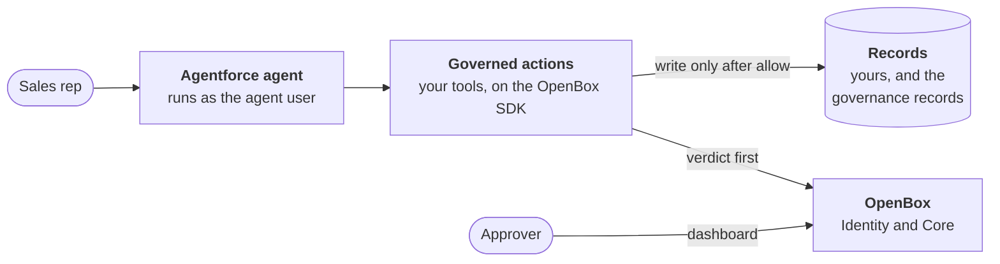
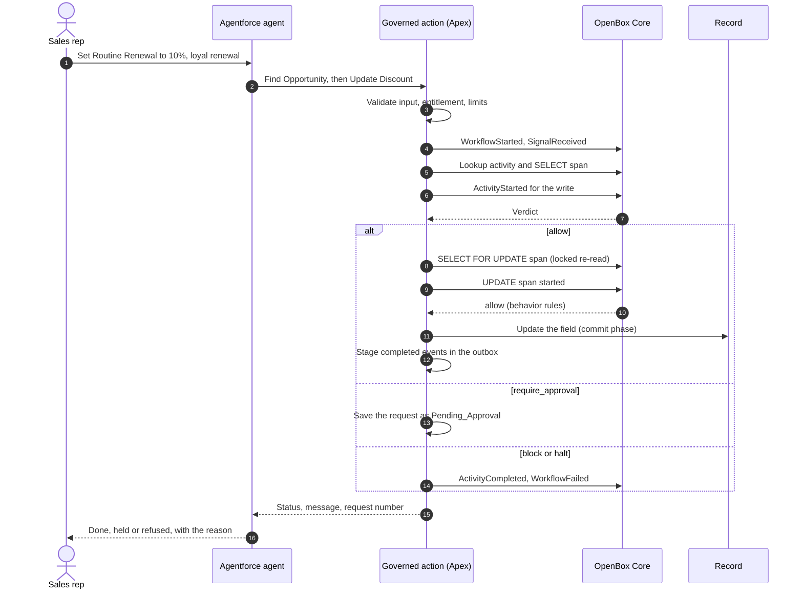

# Salesforce Agentforce Reference

OpenBox for Salesforce Agentforce is an Apex SDK, shipped as the unlocked
package `OpenBoxGovernance`, that puts an Agentforce agent under OpenBox
governance. It runs inside your own org: Salesforce calls OpenBox over HTTPS,
and OpenBox never calls into Salesforce.

Source, issues and releases are in
[OpenBox-AI/openbox-agentforce-sdk](https://github.com/OpenBox-AI/openbox-agentforce-sdk).
To install it, start with [Getting Started with Salesforce Agentforce](/getting-started/salesforce-agentforce).

| Page | What it covers |
|---|---|
| [Building a Governed Agent](/developer-guide/salesforce-agentforce/building-a-governed-agent) | Apex tools, record writes and guarded fields, flows and standard actions, approvals |
| [Configuration](/developer-guide/salesforce-agentforce/configuration) | Settings, permission sets, API key scopes, other environments, several orgs |
| [Security Model](/developer-guide/salesforce-agentforce/security-model) | Fail closed, workload identity, secrets, replay safety, the outbox |
| [Operations and Troubleshooting](/developer-guide/salesforce-agentforce/operations) | Where to look, common failures, testing, building the package |

## Inside your Salesforce org



- **The agent** runs as a dedicated, least-privilege agent user with
  `OpenBox_Governed_Agent`. It reaches your tools only through governed actions.
- **The SDK** asks OpenBox Core for a verdict before anything runs, and writes
  only after an allow. It authenticates with a certificate-signed workload
  identity (see [Security Model](/developer-guide/salesforce-agentforce/security-model)).
- **Credentials** live in the Named Credential `OpenBox_Core`, the External
  Credential `OpenBox_Core_Auth` (the agent's API key) and the certificate
  `OpenBox_Workload`. Apex can read neither the key nor the signing key.
- **Governance records** sit next to your own: `OpenBox_Governed_Request__c`,
  `OpenBox_Governance_Audit__c`, `OpenBox_Agent_Session__c` and
  `OpenBox_Event_Outbox__c`.
- **Approvers** decide held requests in the OpenBox dashboard. OpenBox never
  calls into Salesforce; the org picks up the decision.

## Inside the SDK

The Apex classes behind a governed call.

| Class | Role |
|---|---|
| `OpenBoxToolGovernance` | The entry point. `govern` and `governAll` run a decide phase (callouts only), then one commit phase (all DML) |
| `OpenBoxToolExecutor` | Interface your tool implements; `execute` runs only after OpenBox allows the call |
| `OpenBoxRecordWriter` | Base class for a governed write: you describe the object, record and change; the SDK does the rest |
| `OpenBoxFieldGuard` | Trigger helper: only governed writes can change a guarded field |
| `OpenBoxAccess` | Salesforce permission checks for the requesting user |
| `OpenBoxGovernedRun` | Event order; pairs every started with its completed |
| `OpenBoxEvents`, `OpenBoxSpan` | OpenBox SDK payloads |
| `OpenBoxClient` | HTTP to OpenBox Core: retry once, fail closed |
| `OpenBoxWorkloadIdentity` | Bootstrap, certificate-signed JWT, cached workload token |
| `OpenBoxOutbox`, `OpenBoxOutboxDispatcher` | Delivers post-write events, in order, from a queueable |
| `OpenBoxApprovalPoller` | Queueable that resumes approved requests |

The invocable actions your agent calls are thin wrappers around these:

| Action | Target | Purpose |
|---|---|---|
| Govern User Message (OpenBox) | `apex://OpenBox_GovernMessage` | Checks each user message before the agent reasons about it |
| End Turn (OpenBox) | `apex://OpenBox_EndTurn` | Closes the OpenBox run of the turn after the agent replies |
| Run Governed Tool (OpenBox) | `apex://OpenBox_GovernedAction` | Runs a flow, standard action or Apex registered in `OpenBox_Governed_Tool__mdt` |
| Check Approval (OpenBox Governed) | `apex://OpenBox_CheckApproval` | Checks on, and applies, a request waiting for approval |

## The conversation, end to end

Each user message is one OpenBox run, closed when Salesforce replies. All runs
of a conversation share its `workflow_id` and `session_id`, so the whole
conversation is one session in the OpenBox dashboard.

| When | Event | Decides? |
|---|---|---|
| A user message arrives | `WorkflowStarted` (goal = the message), then `SignalReceived` `user_prompt` | **Yes**: block or approval refuses the message, halt ends the conversation |
| The agent moves to a subagent | `SignalReceived` `subagent_selected` | No |
| The agent calls any tool | `ActivityStarted`, `activity_type` = tool name, `activity_input` = its arguments | **Yes**: the tool runs only on allow; approval holds it |
| The tool finishes | `ActivityCompleted` with the result or error | Read-only tools: output guardrails apply before the agent sees the result |
| Salesforce replies | `WorkflowCompleted` (status `failed` when OpenBox refused the message), queued so the reply is not delayed | No |

A turn that leaves a call waiting for approval stays open until that call is
approved and run, rejected, or expires. Conversations idle for
`Session_Idle_Minutes__c` (60 by default) are closed by an hourly sweep, which
also closes turns whose reply never arrived.

## A governed write, end to end

Shown with the reference agent's discount change; your own writes follow the
same path.



## Request statuses

Every governed tool call and record write is an `OpenBox_Governed_Request__c`
record. Its `Status__c` moves through:

```
Authorizing -> Executed | Blocked | Halted | Permission_Denied | Failed
            -> Pending_Approval -> Approved -> Executed | Failed | Stale | Permission_Denied
                                -> Rejected | Expired | Halted
```

Only `Pending_Approval` and `Approved` are waiting; every other status after
`Authorizing` is final.

## Wire format

A governed write produces this sequence within its run. Events and spans
follow the OpenBox SDK wire format: the lifecycle shapes of the
[LangGraph SDK](/developer-guide/langgraph/event-model) and the flat `SpanData`
spans of the base SDK.

```
WorkflowStarted                       goal = the user's request
SignalReceived      user_prompt
ActivityStarted     <Object>Lookup
  span SELECT <Object>                started → completed
ActivityCompleted   <Object>Lookup    output guardrails may redact what the agent sees
ActivityStarted     <tool name>       ◄ policy rules and input guardrails decide
  span SELECT <Object> (FOR UPDATE)   started → completed    locked re-read
  span UPDATE <Object>                started ◄ behavior rules decide → write → completed
ActivityCompleted   <tool name>
WorkflowCompleted | WorkflowFailed
```

- Every `ActivityStarted` is closed by exactly one `ActivityCompleted` with the
  same `activity_id`, on success, failure or refusal. A span refused at
  `started` is closed as an error. After a `halt`, OpenBox closes the session
  and accepts nothing more.
- Event timestamps strictly increase within a transaction, so stored order
  matches send order.

Your policies match on `activity_type` (the tool name) and read
`activity_input` (its arguments). See [Policies](/trust-lifecycle/authorize/policies)
for how to write rules against them.
