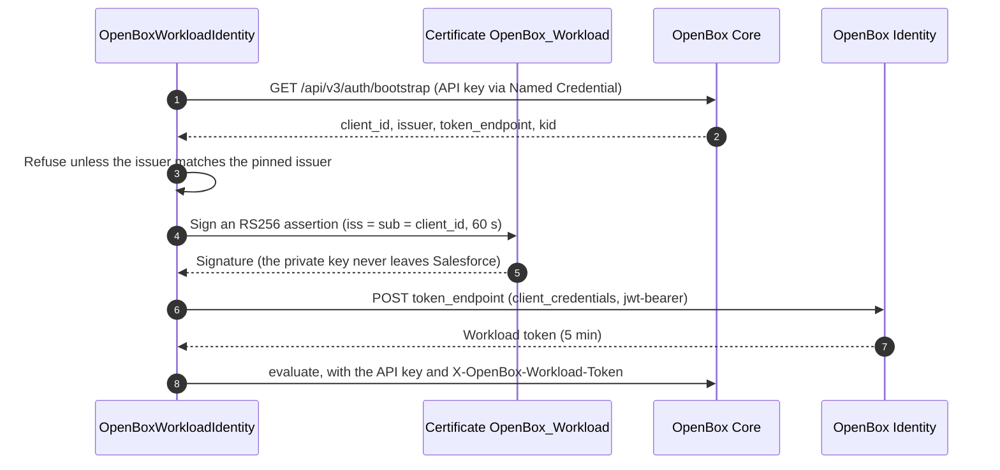
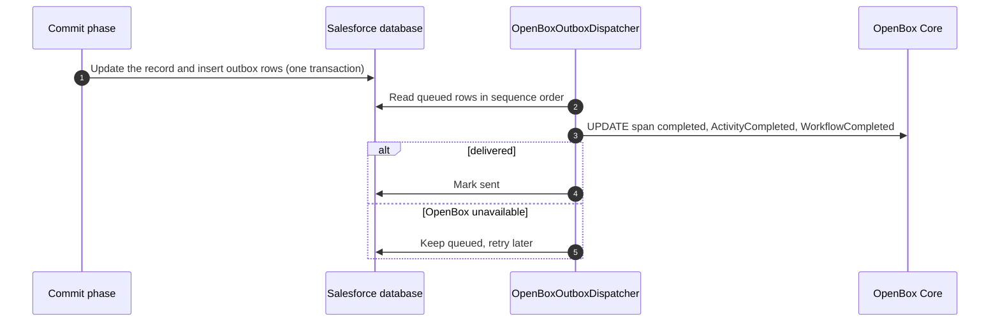

# Security Model

- **The governed write is the only path.** The agent user holds a guarded field
  read-only, and a trigger calling `OpenBoxFieldGuard` rejects any change that
  a governed write has not authorized for that record and field. Agent
  instructions are not relied on.
- **Both systems must agree.** An OpenBox `allow` is followed by Salesforce
  checks for the requesting user: entitlement, object edit, field read and
  record edit access.
- **Fails closed.** Unreachable OpenBox, timeouts, non-2xx answers, malformed
  bodies, unknown verdicts and identity failures all mean no write. Gateway
  errors are retried once with the same idempotency key.
- **Secrets.** The API key lives in the External Credential, encrypted and
  injected at callout time. The signing key never leaves the Salesforce
  certificate store. Neither is logged or kept in source.
- **Workload identity.** Salesforce proves who it is with a
  certificate-signed assertion, exchanged for a short-lived workload token.
  Apex trusts only the issuer pinned in `Identity_Issuer__c`.
- **Replay safety.** A request executes only from `Pending_Approval`, under
  `FOR UPDATE`, and leaves that status in the same transaction: at most one
  committed change per request.
- **Staleness.** If the record changed while the request waited, it is refused
  as `Stale`.

## Workload identity

Salesforce proves who it is without a shared secret leaving the org.
`workload-certificate.mjs` generates the certificate `OpenBox_Workload` inside
Salesforce, and only its public key is registered with OpenBox.

See [Agent Identity](/core-concepts/agent-identity) for how OpenBox uses
workload identities across integrations.

## Events after the write

Apex cannot make a callout after DML in the same transaction, so events that
report a completed write wait in an outbox (`OpenBox_Event_Outbox__c`) and are
delivered in order.

Delivery is attempted up to `Outbox_Max_Attempts__c` times. The write and its
outbox rows commit together, so a write is never recorded in Salesforce
without its events, and the decision that allowed it was already made before
any DML.
