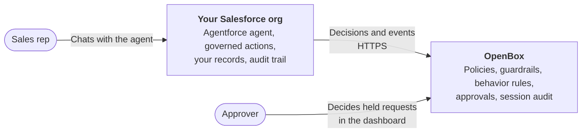

# Getting Started with Salesforce Agentforce

OpenBox integrates with [Salesforce Agentforce](https://www.salesforce.com/agentforce/)
through **OpenBox for Salesforce Agentforce**, an Apex SDK shipped as an unlocked
package. It runs inside your own org. Your agent asks OpenBox about every user
message and every tool call before it acts, and Salesforce enforces the answer.

- **Every user message** is checked by OpenBox before the agent reasons about it.
- **Every tool call** is decided before it runs: `allow`, `require_approval`,
  `block` or `halt`.
- **Any field can be guarded**, so the agent can change it only through a
  governed write, never directly.
- **Policies live in the OpenBox dashboard.** You change them there, without a
  Salesforce deploy.

There is no server to host. Salesforce calls OpenBox over HTTPS, and OpenBox
never calls into Salesforce. If OpenBox cannot answer, nothing is written.

The current release is **1.2.0** (package ID `04tgL000000gFKPQA2`). Source,
issues and releases are in
[OpenBox-AI/openbox-agentforce-sdk](https://github.com/OpenBox-AI/openbox-agentforce-sdk).

Want to see a finished agent first? [Run the Reference Agent](/getting-started/salesforce-agentforce/run-the-reference-agent)
deploys a complete sales agent that looks up Opportunities and changes their
discount, with the discount field guarded and a starting set of policies.

## How it fits



Two things change in your agent:

- **The conversation is hooked.** Two actions run deterministically in Agent
  Script's `before_reasoning` and `after_reasoning`, so the model never acts on
  a message OpenBox has not seen.
- **Tools go through the SDK.** You wrap a tool's work in an
  `OpenBoxToolExecutor` (or describe a record change with an
  `OpenBoxRecordWriter`), and OpenBox decides before it runs. Flows, standard
  actions and invocable Apex can be governed without writing Apex.

## What the user sees

| OpenBox decides | What happens in Salesforce | The agent tells the user |
|---|---|---|
| Allow | The tool runs, or the record is written | The normal result |
| Require approval | Nothing runs yet. The call waits as a `Pending_Approval` governed request | The request number. Once an approver decides in the OpenBox dashboard, the change is applied |
| Block | Nothing runs | OpenBox's refusal, with the reason |
| Halt | Nothing runs, and the conversation ends | OpenBox's refusal |
| No answer in time | Nothing runs (fail closed) | That governance is unavailable |

A refused user message never reaches the model: the agent replies with
OpenBox's message and nothing else.

## Quickstart

You will install the package, connect your org to OpenBox, hook your agent's
conversation, and govern a first tool. Allow about 30 minutes.

**You need**

- A Salesforce org with Agentforce. On a new Developer Edition or scratch org,
  turn on **Einstein** and **Agentforce** once in Setup. Salesforce requires a
  person to accept the terms.
- The Salesforce CLI (`npm install -g @salesforce/cli`), logged in to the org:
  `sf org login web --alias my-org`.
- Node 20 or later, for the setup scripts.
- An OpenBox organization API key (**Organization > API Keys** in the OpenBox
  dashboard) with `create:agent`, `read:agent` and `update:agent`.

### 1. Install the package

```bash
sf package install --package 04tgL000000gFKPQA2 --target-org my-org --wait 30 --no-prompt
```

You can also install it from a browser:
[production and Developer Edition](https://login.salesforce.com/packaging/installPackage.apexp?p0=04tgL000000gFKPQA2),
[sandbox](https://test.salesforce.com/packaging/installPackage.apexp?p0=04tgL000000gFKPQA2).
Every version is listed on the
[releases page](https://github.com/OpenBox-AI/openbox-agentforce-sdk/releases).

### 2. Connect the org to OpenBox

The setup scripts live in the SDK repository. They need no `npm install`.

```bash
git clone https://github.com/OpenBox-AI/openbox-agentforce-sdk.git
cd openbox-agentforce-sdk
cp .env.example .env
```

In `.env`, set `OPENBOX_ORG_API_KEY` to your key, `OPENBOX_AGENT_NAME` to the
name your agent should have in OpenBox, and `SF_TARGET_ORG` to your org alias
(the scripts use it when you don't pass `--target-org`). Then:

```bash
# A signing certificate generated inside Salesforce; only its public key leaves the org
node scripts/salesforce/workload-certificate.mjs

# Register your agent in OpenBox with that public key
node scripts/openbox/provision.mjs --agent-only

# Store the agent's runtime key in the External Credential OpenBox_Core_Auth
node scripts/salesforce/set-credential.mjs
```

`provision.mjs` writes the agent's runtime key straight to `.env` and never
prints it. `set-credential.mjs` moves it into Salesforce's encrypted credential
store, where Apex cannot read it.

### 3. Set up users and the approval poller

```bash
# You, as the administrator
sf org assign permset --name OpenBox_Governance_Admin --target-org my-org

# A dedicated agent user with OpenBox_Governed_Agent; it prints the username and saves it to .env
node scripts/salesforce/create-agent-user.mjs

# The hourly safety net that resumes approved requests
echo "OpenBoxApprovalPollerSchedule.install();" | sf apex run --target-org my-org
```

To use an agent user you already have, assign it `OpenBox_Governed_Agent`
instead of creating one. The agent user also needs access to your own Apex
classes (step 5) through a permission set of yours.

### 4. Hook the conversation in Agent Script

In your agent's `.agent` file, add a conversation key variable and the two
conversation actions. Then run them around the reasoning of the start agent
and of every subagent:

```yaml title="My_Agent.agent (excerpt)"
config:
    default_agent_user: "<the username create-agent-user.mjs printed>"

variables:
    ob_conversation_key: mutable string = ""
        description: "OpenBox conversation key; passed to every OpenBox action"
    ob_allowed: mutable boolean = True
        description: "Whether OpenBox allowed the agent to act on the latest message"
    ob_message: mutable string = ""
        description: "What to tell the user when OpenBox refused the latest message"

start_agent agent_router:
    actions:
        openbox_govern_message:
            description: "Checks the user's message with OpenBox before the agent acts on it."
            label: "Govern User Message (OpenBox)"
            target: "apex://OpenBox_GovernMessage"
            inputs:
                userInput: string
                    label: "User Message"
                    is_required: False
                conversationKey: string
                    label: "Conversation Key"
                    is_required: False
                subagent: string
                    label: "Subagent"
                    is_required: False
            outputs:
                allowed: boolean
                    label: "Allowed"
                    is_displayable: False
                    filter_from_agent: False
                conversationKey: string
                    label: "Conversation Key"
                    is_displayable: False
                    filter_from_agent: False
                message: string
                    label: "Message"
                    is_displayable: False
                    filter_from_agent: False
        openbox_end_turn:
            description: "Closes the OpenBox run of this turn after the agent has replied."
            label: "End Turn (OpenBox)"
            target: "apex://OpenBox_EndTurn"
            inputs:
                conversationKey: string
                    label: "Conversation Key"
                    is_required: False
            outputs:
                closed: boolean
                    label: "Closed"
                    is_displayable: False
                    filter_from_agent: False

    before_reasoning:
        run @actions.openbox_govern_message
            with userInput = @system_variables.user_input
            with conversationKey = @variables.ob_conversation_key
            with subagent = ""
            set @variables.ob_conversation_key = @outputs.conversationKey
            set @variables.ob_allowed = @outputs.allowed
            set @variables.ob_message = @outputs.message
        if @variables.ob_allowed == False:
            transition to @subagent.governance_refused

    after_reasoning:
        run @actions.openbox_end_turn
            with conversationKey = @variables.ob_conversation_key
```

Add the same `before_reasoning` and `after_reasoning` blocks, and the same two
actions, to every subagent. Then add the subagent the router sends refused
messages to:

```yaml
subagent governance_refused:
    label: "Governance Refused"
    description: "Used only when OpenBox governance refused the user's latest message."
    actions:
        openbox_end_turn:
            # the same declaration as above
    reasoning:
        instructions: ->
            | OpenBox governance refused the user's latest message, so you must not act on it.
              Reply with exactly this message and nothing else: {!@variables.ob_message}
    after_reasoning:
        run @actions.openbox_end_turn
            with conversationKey = @variables.ob_conversation_key
```

The [reference agent's Agent Script](https://github.com/OpenBox-AI/openbox-agentforce-sdk/blob/main/reference-agent/main/default/aiAuthoringBundles/OpenBox_Sales_Agent/OpenBox_Sales_Agent.agent)
is a complete, working file to copy from, subagents included.

### 5. Govern your first tool

Wrap the tool's work in an `OpenBoxToolExecutor`, and route the call through
`OpenBoxToolGovernance`. OpenBox decides before `execute` runs.

```apex title="FindAccount.cls"
public with sharing class FindAccount {
    public class Request {
        @InvocableVariable(label='Account Name' required=true)
        public String name;
        @InvocableVariable(label='Conversation Key')
        public String conversationKey;
    }

    public class Result {
        @InvocableVariable(label='Message')
        public String message;
        @InvocableVariable(label='Account ID')
        public Id accountId;
    }

    /** The tool's work. It runs only after OpenBox allows the call. */
    public class Finder implements OpenBoxToolExecutor {
        public Map<String, Object> execute(OpenBoxToolContext context, Map<String, Object> input) {
            String term = String.valueOf(input.get('name')).replace('\\', '\\\\').replace('%', '\\%').replace('_', '\\_');
            String pattern = '%' + term + '%';
            List<Account> found = [SELECT Id, Name FROM Account WHERE Name LIKE :pattern WITH USER_MODE LIMIT 1];
            return new Map<String, Object>{
                'account_id' => found.isEmpty() ? null : found[0].Id,
                'name' => found.isEmpty() ? null : found[0].Name
            };
        }
    }

    @InvocableMethod(label='Find Account' description='Finds an Account by name and returns its record id.')
    public static List<Result> find(List<Request> requests) {
        List<OpenBoxToolGovernance.ToolCall> calls = new List<OpenBoxToolGovernance.ToolCall>();
        for (Request request : requests) {
            OpenBoxToolGovernance.ToolCall call = new OpenBoxToolGovernance.ToolCall();
            call.sessionKey = request.conversationKey;                 // joins the conversation's OpenBox session
            call.toolName = 'find_account';                            // the activity_type your policies match on
            call.input = new Map<String, Object>{ 'name' => request.name };
            call.targetType = OpenBoxToolGovernance.TARGET_APEX_EXECUTOR;
            call.targetName = Finder.class.getName();
            call.readOnly = true;
            calls.add(call);
        }
        List<Result> results = new List<Result>();
        for (OpenBoxToolGovernance.Result outcome : new OpenBoxToolGovernance().governAll(calls)) {
            Result result = new Result();
            if (outcome.executed && outcome.output != null && outcome.output.get('account_id') != null) {
                result.accountId = Id.valueOf(String.valueOf(outcome.output.get('account_id')));
                result.message = 'Found ' + outcome.output.get('name') + '.';
            } else {
                result.message = outcome.message;                      // OpenBox's refusal, or "not found"
            }
            results.add(result);
        }
        return results;
    }
}
```

`governAll` decides every call before any of them runs, so a batch never makes
a callout after DML.

Declare the action in Agent Script, and pass it the conversation key. An `Id`
(or `Integer`) input or output must declare its Lightning type:

```yaml
        find_account:
            description: "Finds an Account by name."
            label: "Find Account"
            target: "apex://FindAccount"
            inputs:
                name: string
                    label: "Account Name"
                    is_required: True
                conversationKey: string
                    label: "Conversation Key"
                    is_required: False
            outputs:
                message: string
                    label: "Message"
                    is_displayable: False
                    filter_from_agent: False
                accountId: object
                    complex_data_type_name: "lightning__recordIdType"
                    label: "Account ID"
                    is_displayable: False
                    filter_from_agent: False
```

```yaml
    reasoning:
        actions:
            find_account: @actions.find_account
                with name = ...
                with conversationKey = @variables.ob_conversation_key
```

### 6. Publish and try it

From your own Salesforce DX project, the one that holds `FindAccount` and your
agent's bundle:

```bash
sf project deploy start --source-dir force-app --target-org my-org
sf agent publish authoring-bundle --api-name My_Agent --target-org my-org
sf agent activate --api-name My_Agent --target-org my-org
sf agent preview --api-name My_Agent --target-org my-org
```

Ask the agent to find an Account. Then, in the OpenBox dashboard, open your
agent:

- **Sessions** shows the conversation: the user message, the `find_account`
  call and OpenBox's verdict for each.
- **Add a policy rule** that blocks `activity_type` `find_account`, and ask
  again. The agent now replies with OpenBox's refusal, and the lookup never
  runs.

That is the whole loop.

## Next steps

- [Run the Reference Agent](/getting-started/salesforce-agentforce/run-the-reference-agent): a complete governed sales agent with a guarded field and starting policies.
- [Building a Governed Agent](/developer-guide/salesforce-agentforce/building-a-governed-agent): record writes and guarded fields, flows and standard actions, approvals.
- [Configuration](/developer-guide/salesforce-agentforce/configuration): settings, permission sets, API key scopes, other environments and several orgs.
- [Operations and Troubleshooting](/developer-guide/salesforce-agentforce/operations): where to look, and what to do when something fails.
